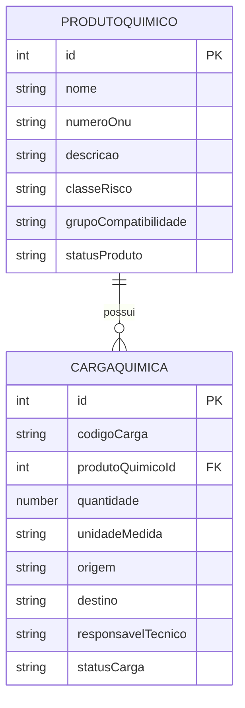
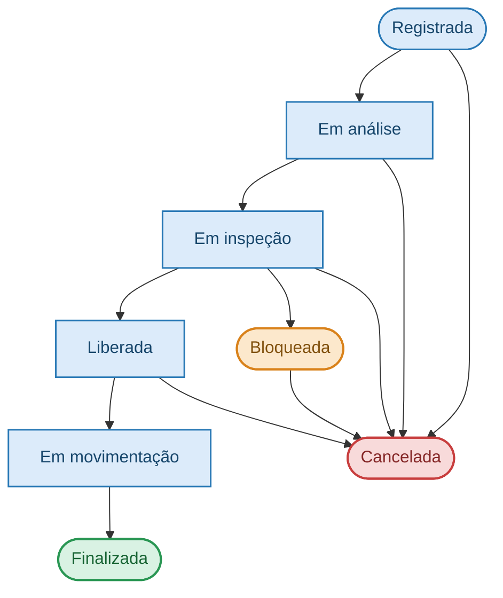

# Banco de Dados

## 1. Visão geral

O QuimiPort utiliza o **PostgreSQL** como sistema gerenciador de banco de dados relacional (SGBD), responsável por armazenar e disponibilizar os dados relacionados aos produtos químicos e às cargas químicas gerenciadas pela aplicação.

A escolha do PostgreSQL permite trabalhar com integridade referencial, restrições de dados, relacionamentos entre tabelas e recursos necessários para garantir a consistência das informações persistidas.

## 2. Modelagem de dados

A estrutura do banco de dados está organizada principalmente em duas tabelas:

- `produtoquimico`: armazena os dados cadastrais e as informações de classificação dos produtos químicos.
- `cargaquimica`: armazena os dados das cargas químicas registradas no sistema e suas informações operacionais.

### 2.1. Tabela `produtoquimico`

Responsável por armazenar as informações dos produtos químicos cadastrados.

Entre os principais atributos do domínio estão:

| Atributo | Descrição |
|---|---|
| ID | Identificador do produto químico. |
| Nome | Nome do produto químico. |
| Número ONU | Código de identificação do produto para transporte de produtos perigosos. |
| Descrição | Informações descritivas do produto. |
| Classe de risco | Classificação de risco do produto químico. |
| Grupo de compatibilidade | Grupo de compatibilidade do produto. |
| Status do produto | Indica se o produto está ativo ou inativo. |
| Data de criação | Data de cadastro do produto. |
| Data de atualização | Data da última alteração cadastral. |

A tabela mantém os dados necessários para identificar e classificar os produtos químicos utilizados no gerenciamento das cargas.

### 2.2. Tabela `cargaquimica`

Responsável por armazenar as informações das cargas químicas registradas no sistema.

Entre os principais atributos do domínio estão:

| Atributo | Descrição |
|---|---|
| ID | Identificador da carga química. |
| Código da carga | Código utilizado para identificar a carga. |
| Produto químico ID | Referência ao produto químico associado à carga. |
| Quantidade | Quantidade do produto transportado ou armazenado. |
| Unidade de medida | Unidade utilizada para representar a quantidade. |
| Origem | Local de origem da carga. |
| Destino | Local de destino da carga. |
| Responsável técnico | Responsável técnico vinculado à carga. |
| Documentos obrigatórios | Informações referentes à documentação exigida para a carga. |
| Status da carga | Situação atual da carga no processo operacional. |
| Data de criação | Data de registro da carga. |
| Data de atualização | Data da última atualização da carga. |

A documentação obrigatória contempla informações como nota fiscal, declaração do expedidor, ficha de dados de segurança e certificado de transporte de produtos perigosos.

## 3. Relacionamento entre as tabelas

A tabela `cargaquimica` possui uma referência ao produto químico por meio do atributo `produtoQuimicoId`.

Esse relacionamento permite associar cada carga a um produto químico previamente cadastrado, evitando a duplicação das informações cadastrais do produto.

O relacionamento é representado conceitualmente da seguinte maneira:

## 4. Controle de Status da Carga Química

O status da carga química representa sua situação atual dentro do processo operacioanl.

O controle é realizado pela aplicação, por meio das regras de negócio implementadas no domínio, que determinam quais transições de status são permitidas.

O fluxo principal operacional contempla os seguintes estados:

## 5. Persistência e arquitetura

A comunicação com o PostgreSQL é realizada utilizando a biblioteca `pg` (node-postgres), por meio de um pool de conexões.

A persistência segue os princípios da Arquitetura Hexagonal, mantendo as regras de negócio independentes da tecnologia utilizada para armazenar os dados.

O fluxo de persistência ocorre da seguinte maneira:

1. Uma requisição chega à API por meio de uma rota e seu respectivo adaptador de entrada.
2. O caso de uso executa a operação solicitada.
3. As regras de negócio são aplicadas às entidades do domínio.
4. O caso de uso utiliza o contrato do repositório para solicitar a operação de persistência.
5. O adaptador de saída implementa esse contrato e realiza a comunicação com o PostgreSQL.
6. O resultado da operação retorna às camadas responsáveis pelo processamento da requisição.

Essa organização permite substituir ou modificar a tecnologia de persistência sem exigir que as regras de negócio dependam diretamente do PostgreSQL.

## 6. Considerações finais

A modelagem do banco de dados do QuimiPort foi organizada para atender às necessidades de gerenciamento de produtos e cargas químicas, mantendo o relacionamento entre essas informações e permitindo a aplicação das regras de negócio definidas pelo domínio.

A utilização do PostgreSQL, associada à persistência por repositórios e à Arquitetura Hexagonal, contribui para a organização, integridade e evolução da solução.

A estrutura permite ampliar as informações armazenadas e incorporar novas funcionalidades conforme as necessidades do domínio.

Entre as possíveis evoluções estão:

- Inclusão de novos atributos para produtos e cargas químicas;

- Ampliação das informações documentais;

- Registro detalhado do histórico de alterações e movimentações;

- Inclusão de novas informações de rastreabilidade;

- Expansão dos dados utilizados em consultas, indicadores e relatórios.